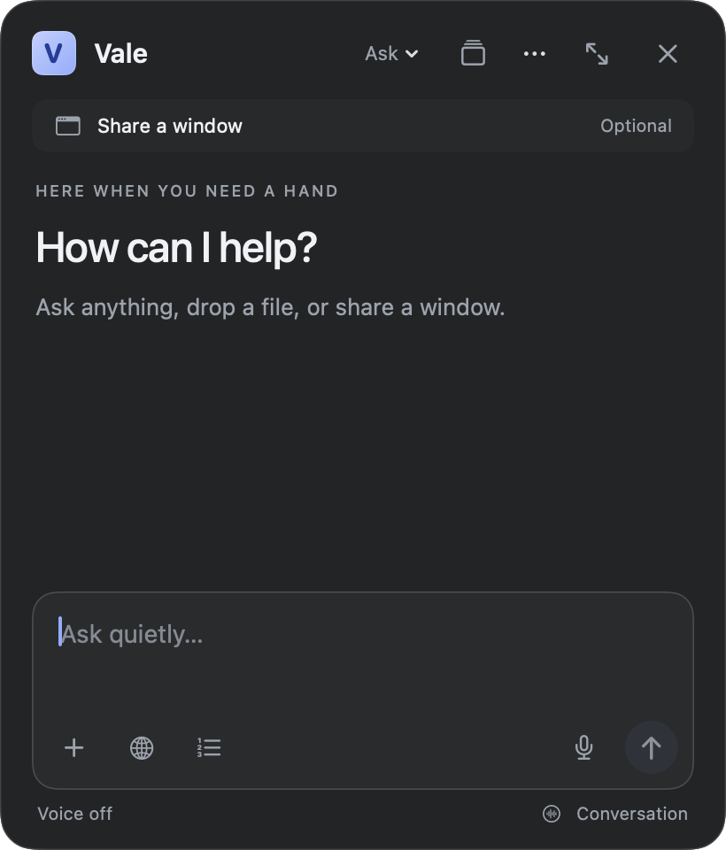

# Vale

A native Mac companion for writing, coding, documents, and talking through what is on your screen. Open it and type. General chat is the default; Learn and step-by-step help are optional. The app keeps the compact dark floating interface and can expand for a longer conversation.


<details>
<summary>Open conversation view</summary>



</details>

Screenshots show native app views from an isolated generated test session.

## Work with your screen

1. Choose **Share a window** and select exactly the window you want to discuss. Preview it whenever you need to check the scope.
2. Turn on **Live** to refresh that window locally about every two seconds. It keeps one current preview in memory. Images are sent when you ask a question or request a guide step, not on every refresh.
3. Type a question, choose **Talk**, or opt in to **Conversation**. Conversation takes turns: listen, answer, then listen again. Tap the microphone to interrupt an answer. Typing stops dictation and ends hands-free turn-taking.
4. Use the numbered-list button for a short step guide. Back/Next asks for help at that step with fresh context. Progress is saved with the chat; the assistant never treats navigation as proof that an action happened.
5. **Pause** or **Escape** stops voice, pending replies, sharing, and highlights. A new chat or sleep/lock also clears live context. Resume does not restart the microphone or sharing automatically.

The selected window is the capture boundary, including whichever page is visible inside it. There is no automatic frontmost-window selection, full-display fallback, or continuous cloud video transmission. If the window changes while an answer is being prepared, the answer is marked and its point/guide is withheld; use Refresh for the current view. Missing geometry prevents pointing with a visible explanation. Hidden windows stop capture; a covered highlight is suppressed with visible feedback.

This release uses Apple dictation/speech and the official Codex CLI's existing ChatGPT sign-in. Voice is interruption-safe turn-taking with final provider replies. It is not network streaming or full-duplex audio. No paid API fallback or new service is configured.

## Everyday use

The capsule stays small. Hover it, or press Control–Option–Space, Down, Return, or Space while it is focused, and the conversation opens downward from that same panel. Escape hides it again. Return sends, Shift–Return inserts a newline, and Command–N starts a chat. A shortcut conflict is reported rather than silently cleared.

Add images, PDFs, UTF-8 text, or code through **+**, drop, or paste. Up to eight files/chat, 25 MB each. Click to preview and × to remove. Uploaded files stay with messages; screen captures and microphone recordings are not saved in chat history.

History supports search, rename, notes, continue, Markdown export, and confirmed Forget. Forget purges that chat from both the active library and the legacy migration backup while keeping unrelated chats. Deletion failures retain a retryable chat/attachment and show an error; Retry Forget finishes the operation when the failure is resolved. Open previews close when their files are forgotten; sharing previews close on stop.

Long conversations show a context notice: recent messages/excerpts are sent, while the full saved history remains available. Web search is optional per chat using the globe. Voice settings provide language, system voice, speed, and silence timing.

## Build and verify

macOS 14+, Command Line Tools with a macOS 15.2+ SDK (verified with Swift 6.1.2), and an existing signed-in Codex CLI are required. Pointing geometry requires macOS 15.2+. SwiftPM resolves the pinned official Sparkle 2.10.0 framework.

```sh
scripts/build.sh
VALE_ARCH=universal scripts/verify.sh --integration --repeat
python3 scripts/package-release.py
```

Tests use isolated generated files and labeled synthetic capture/voice adapters. The provider integration also asks the real signed-in service using public image/PDF/text fixtures and a synthetic selected-window image. It does not request hardware consent or alter real chats. See [verification](docs/verification.md) for exactly what is exercised and still pending.

The local app is ad-hoc signed, not notarized. Production updates are implemented but inactive until trusted existing signing/feed assets are supplied. Laptop installation, Apple Silicon runtime, and real hardware QA remain pending. No notch integration, persistent agents, routines, connectors, or autonomous computer actions are included.

## Working on Vale

Start with [AGENTS.md](AGENTS.md), [architecture](docs/architecture.md), and the [development roadmap](docs/roadmap.md). Public source lives at [AgarwalAarush/Vale](https://github.com/AgarwalAarush/Vale).

The app bundle is `Vale.app`. Swift targets/executable (`Lilt`, `LiltCore`, `LiltCoreChecks`), bundle ID (`local.lilt.companion`), saved preference keys, and `Application Support/Lilt` intentionally retain their legacy names so existing chats and permissions stay compatible. Lilt remains the assistant persona.
